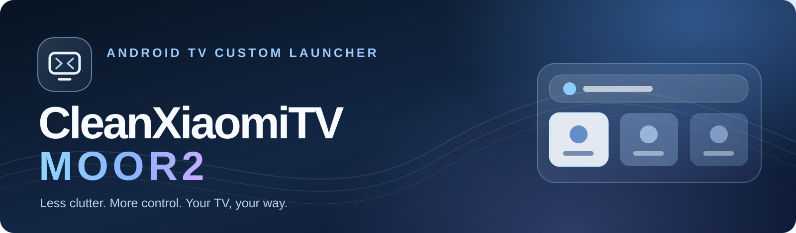
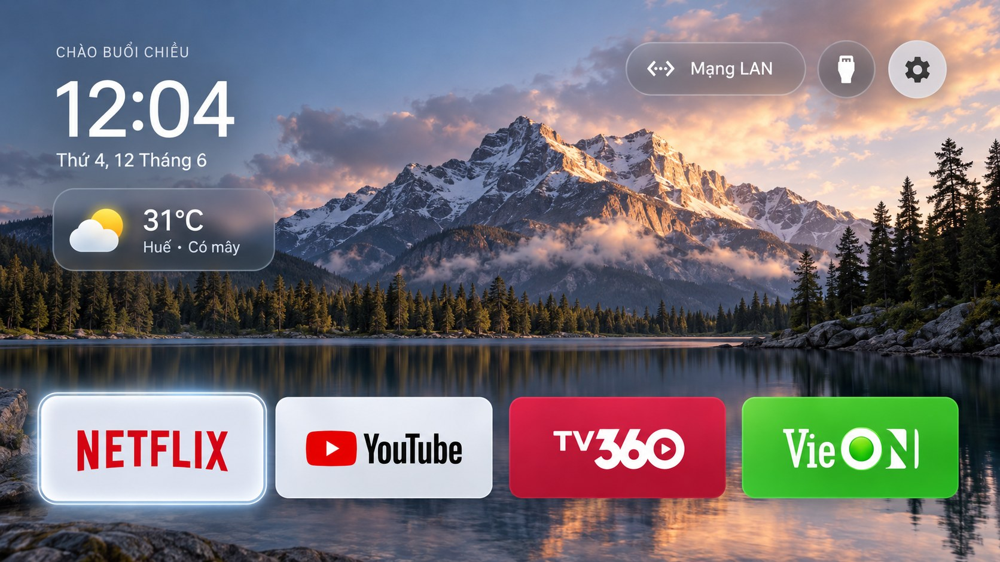
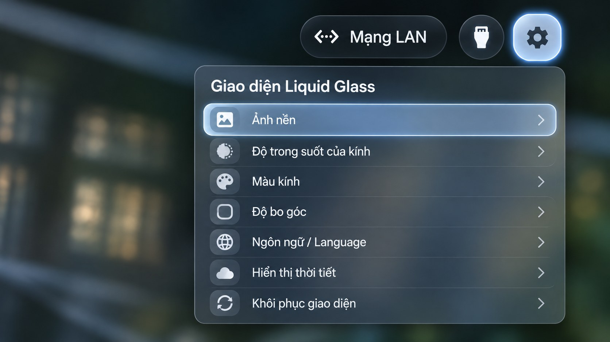

<!-- CleanXiaomiTV MOOR2 | GitHub README -->

<div align="center">
  

  <br />
  <strong>Một màn hình chính gọn gàng. Một trải nghiệm TV đậm chất riêng.</strong>
  <br />
  <sub>Launcher tùy biến dành cho Xiaomi MiTV-MOOR2 · Giao diện Liquid Glass · Điều khiển tối ưu bằng remote</sub>
  <br /><br />

  <a href="https://github.com/lylyhecker/CleanXiaomiTV_MOOR2/releases"></a>
  <a href="https://github.com/lylyhecker/CleanXiaomiTV_MOOR2/blob/main/update.json"></a>
  <a href="https://github.com/lylyhecker/CleanXiaomiTV_MOOR2/issues"></a>

  <br /><br />
  
  
  
  
  <br /><br />
  <a href="#tong-quan">Tổng quan</a> ·
  <a href="#giao-dien">Giao diện</a> ·
  <a href="#tinh-nang">Tính năng</a> ·
  <a href="#cai-dat">Cài đặt</a> ·
  <a href="#cap-nhat-ota">Cập nhật OTA</a> ·
  <a href="#xu-ly-su-co">Xử lý sự cố</a>
</div>

---

<a id="tong-quan"></a>

## ✨ Tổng quan

**CleanXiaomiTV MOOR2** là dự án tùy biến màn hình Home cho **Xiaomi MiTV-MOOR2**, tập trung vào ba điều: **giao diện đẹp**, **thao tác bằng remote mượt mà** và **giữ lại các tiện ích TV thiết yếu**.

Thay vì một màn hình Home nhiều thành phần khó dùng, dự án hướng tới không gian hiển thị thoáng, Dock dễ tùy chỉnh, hiệu ứng focus tinh tế và khu vực thông tin hữu ích ngay trên TV.

> [!IMPORTANT]
> **Phân biệt bản phát hành và bản phát triển:** Repository này chứa manifest OTA và các gói tùy biến. Một số tính năng mô tả bên dưới thuộc **nhánh/bộ vá phát triển v11–v17**, chưa được xác nhận là có đầy đủ trong mọi APK tại **Releases**. Hãy xem ghi chú của từng bản phát hành và kiểm tra APK trước khi cài.

<a id="giao-dien"></a>

## 🖼️ Giao diện

<div align="center">
  
  <br />
  <sub>Home · Dock ứng dụng · Thanh công cụ · Đồng hồ và thông tin thời tiết</sub>
  <br /><br />
  
  <br />
  <sub>Appearance · Tùy chỉnh độ trong suốt, màu kính, bo góc và hình nền</sub>
</div>

> **Lưu ý:** Hai hình trên là **ảnh thiết kế minh họa**, không phải ảnh chụp trực tiếp từ APK phát hành. Giao diện thực tế có thể khác theo phiên bản và firmware.

<a id="tinh-nang"></a>

## 🚀 Tính năng

| Nhóm | Trải nghiệm hướng tới |
| :-- | :-- |
| **🫧 Liquid Glass** | Nền kính mờ, bo góc, màu sắc và các trạng thái focus theo phong cách đồng nhất. |
| **🧩 Dock ứng dụng** | Tùy chỉnh tối đa **4 ứng dụng**; thêm, bớt, thay đổi vị trí ngay bằng remote. |
| **✨ Focus Animation** | Phóng nhẹ ô được chọn, viền sáng; hạn chế hiện tượng bị lẹm/cắt cạnh. |
| **📊 Top Monitor** | CPU, RAM và tốc độ truyền dữ liệu mạng; số liệu phụ thuộc quyền truy cập của firmware. |
| **🌙 Lịch âm Việt Nam** | Ngày/tháng âm lịch và năm Can Chi phía trên đồng hồ chính, kể cả tháng nhuận. |
| **🎮 Menu nhấn giữ** | Mở app, di chuyển, ghim/bỏ ghim Dock, sắp xếp và xem thông tin ứng dụng. |
| **📡 Kết nối & đầu vào** | Lối tắt Wi-Fi/LAN, Inputs/HDMI và Settings từ thanh công cụ. |
| **🔄 OTA Update** | Kiểm tra phiên bản, tải APK và xác minh SHA-256 trước khi yêu cầu cài đặt. |

<details>
<summary><b>Trạng thái triển khai và những giới hạn cần biết</b></summary>
<br />

- **Giao diện gốc + OTA:** có trong dòng dự án và các gói vá trước đó; cần đối chiếu từng APK phát hành.
- **Dock 4 app, CPU/RAM/Internet Speed, lịch âm, menu nhấn giữ, sửa focus:** đã được tích hợp trong bộ mã khôi phục/phát triển v17, **chưa được coi là đã thử nghiệm thành công trên mọi TV**.
- **CPU Monitor:** nếu Android chặn `/proc/stat`, widget có thể chỉ hiển thị mức dùng CPU của ứng dụng launcher (*APP CPU*), không phải toàn TV.
- **Độ trong suốt Liquid Glass:** một số hộp thoại cũ có thể còn dùng tài nguyên màu cố định và cần được kiểm tra riêng.
- **Thời tiết và dịch vụ mạng:** cần cấu hình phù hợp; khả năng cập nhật tùy kết nối và firmware.

</details>

<a id="cai-dat"></a>

## 📦 Cài đặt

### Cách 1 — Cài APK từ bản phát hành

1. Mở trang **[Releases](https://github.com/lylyhecker/CleanXiaomiTV_MOOR2/releases)**.
2. Chọn bản dành cho **MiTV-MOOR2**, đọc ghi chú và tải APK nếu bản đó có đính kèm tệp cài đặt.
3. Cấp quyền gỡ lỗi ADB trên TV và kết nối máy tính với TV qua mạng nội bộ.
4. Từ **PowerShell/CMD**, kiểm tra thiết bị rồi cài APK:

```powershell
adb devices
adb install -r "CleanXiaomiTV_MOOR2.apk"
```

**`-r`** là cài đè, cố gắng giữ dữ liệu ứng dụng hiện tại. Android chỉ cho cài đè khi **cùng package name, chữ ký tương thích và phiên bản hợp lệ**.

> [!CAUTION]
> **Không gỡ launcher đang dùng chỉ để vượt lỗi chữ ký.** Nếu xuất hiện `INSTALL_FAILED_UPDATE_INCOMPATIBLE`, hãy dùng APK được ký bởi đúng khóa của phiên bản đã cài. Đảm bảo có cách quay lại Home gốc trước khi thay đổi launcher mặc định.

### Cách 2 — Build từ mã nguồn đang phát triển

Bộ mã nguồn và công cụ khôi phục/build có thể được quản lý riêng với repository OTA này. Khi bạn có thư mục nguồn `launcher`, hãy chuẩn bị:

- **Windows**, **JDK 17+**, Android SDK và công cụ Android SDK phù hợp với `build.gradle`.
- Android Platform Tools (`adb`) và Gradle Wrapper trong dự án.
- Tệp `local.properties` có `sdk.dir` trỏ đến Android SDK hợp lệ.

Tại **thư mục `launcher` chứa `gradlew.bat`**, chạy:

```powershell
.\gradlew.bat clean :app:assembleDebug --console=plain --no-daemon
```

APK debug thường xuất hiện tại:

```text
app/build/outputs/apk/debug/app-debug.apk
```

> [!NOTE]
> APK **debug** không mặc nhiên cài đè được bản **release**. Để cập nhật OTA/cài đè, cần dùng **cùng khóa ký** với bản đang có trên TV.

<a id="cap-nhat-ota"></a>

## 🔄 Cập nhật OTA

Manifest OTA của dự án: **[`update.json`](https://github.com/lylyhecker/CleanXiaomiTV_MOOR2/blob/main/update.json)**.

Một bản cập nhật hợp lệ cần đồng thời đáp ứng:

1. **`packageName`** trùng ứng dụng đã cài.
2. **`versionCode` của APK = `versionCode` trong manifest**, và **lớn hơn** mã đang cài trên TV.
3. **`versionName`** khớp với tên phiên bản thực tế trong APK.
4. **`apkUrl`** trỏ tới đúng APK đã phát hành, không phải tệp còn nằm trên máy tính.
5. **`sha256`** khớp chính xác với APK tải từ `apkUrl`.
6. **Chữ ký APK** tương thích với ứng dụng đang được cài đặt.

<details>
<summary><b>Ví dụ cấu trúc update.json</b></summary>

```json
{
  "packageName": "com.majnioui.cleanxiaomitv",
  "versionCode": 12,
  "versionName": "1.1.1",
  "apkUrl": "https://github.com/lylyhecker/CleanXiaomiTV_MOOR2/releases/download/v1.1.1/CleanXiaomiTV_MOOR2.apk",
  "sha256": "THAY_BANG_SHA256_THUC_TE_DU_64_KY_TU_HEX",
  "notes": "Cập nhật giao diện và sửa lỗi"
}
```

**Đây là ví dụ minh họa, không phải manifest đã phát hành.** Không sao chép mã phiên bản/URL/SHA-256 này lên nhánh `main` nếu chưa có APK khớp.

</details>

### Tự kiểm tra SHA-256 của APK trên GitHub

```powershell
$manifest = Invoke-RestMethod "https://raw.githubusercontent.com/lylyhecker/CleanXiaomiTV_MOOR2/main/update.json"
$download = Join-Path $env:TEMP "MOOR2_OTA_CHECK.apk"
Invoke-WebRequest -Uri $manifest.apkUrl -OutFile $download
$actual = (Get-FileHash $download -Algorithm SHA256).Hash
$expected = $manifest.sha256
"APK SHA256:      $actual"
"Manifest SHA256: $expected"
if ($actual -ieq $expected) { "PASS: SHA256 khớp" } else { "FAIL: SHA256 không khớp" }
```

### Quy tắc phiên bản tự động (bộ công cụ phát triển)

```text
1.0.9  → 1.0.10 → 1.0.11 → 1.1.1 → 1.1.2 ... → 1.1.11 → 1.2.1
```

`versionName` có thể chuyển mốc như trên, nhưng **`versionCode` phải là số nguyên tăng dần**. Ví dụ `versionCode = 11` → `12` khi chuyển `1.0.11` → `1.1.1`.

<a id="xu-ly-su-co"></a>

## 🛠️ Xử lý sự cố

| Vấn đề | Cách kiểm tra |
| :-- | :-- |
| **SHA256 không khớp** | Tải lại APK từ chính `apkUrl`, tính SHA-256, rồi cập nhật JSON sau khi đã phát hành đúng APK. |
| **APK không khớp manifest / không mới hơn** | So sánh `versionCode` trong APK, `update.json` và TV. |
| **`INSTALL_FAILED_UPDATE_INCOMPATIBLE`** | Hai APK không cùng chữ ký; build bằng khóa ký tương thích. |
| **`INSTALL_FAILED_VERSION_DOWNGRADE`** | Tăng `versionCode` rồi build lại. |
| **`SDK location not found`** | Cấu hình `sdk.dir` trong `local.properties` hoặc `ANDROID_HOME`. |
| **`windowDimAmount not found`** | Kiểm tra tài nguyên theme dùng thuộc tính Android không được SDK nhận diện. |
| **File `.bak` làm lỗi `mergeDebugResources`** | Di chuyển bản sao lưu **ra ngoài** `app/src/main/res`. |
| **CPU Monitor hiển thị `--`** | Firmware có thể chặn CPU toàn hệ thống; thử phương án APP CPU nếu bản build hỗ trợ. |
| **Focus bị cắt viền** | Kiểm tra `clipChildren`, `clipToPadding` và khoảng trống trong các lớp cha của view. |
| **APK nhỏ, thiếu tính năng** | Kiểm tra lớp/tài nguyên thực sự được đóng gói vào APK; kích thước không đủ để kết luận. |

## 🛡️ Nguyên tắc an toàn

- Ưu tiên **giữ nguyên ứng dụng TV và dịch vụ hệ thống** như Netflix, YouTube, HDMI/Live TV, Chromecast, trợ lý giọng nói và cập nhật firmware.
- Không khuyến nghị xóa các gói hệ thống để cài giao diện mới; sao lưu cấu hình trước khi thay đổi.
- Không mở cổng ADB ra Internet. Tắt gỡ lỗi mạng sau khi hoàn tất nếu không còn cần thiết.
- OTA chỉ cài đè khi Android xác minh đầy đủ các điều kiện; **không bỏ qua kiểm tra chữ ký/phiên bản**.

## 🗺️ Định hướng phát triển

- [ ] Kiểm thử và phát hành một APK **đầy đủ các tính năng v17**.
- [ ] Đồng bộ thanh trượt độ trong suốt với toàn bộ hộp thoại Liquid Glass.
- [ ] Kiểm thử CPU/RAM/NET Monitor trên nhiều phiên bản firmware MOOR2.
- [ ] Bổ sung ảnh chụp giao diện thực tế và video thao tác bằng remote.
- [ ] Tự động hóa kiểm tra APK, phiên bản và manifest trước khi phát hành OTA.

## 🤝 Đóng góp & hỗ trợ

Bạn phát hiện lỗi, có đề xuất giao diện hoặc muốn đóng góp bản dịch? Hãy mở một **[Issue](https://github.com/lylyhecker/CleanXiaomiTV_MOOR2/issues)** và đính kèm thông tin phiên bản, model TV, mô tả lỗi và log ADB/Gradle (nếu có). **Không đăng mật khẩu, mã truy cập hoặc khóa ký lên Issue.**

### Ghi nhận

Dự án sử dụng và tùy biến ý tưởng/mã nguồn từ **[majnioui/CleanXiaomiTV](https://github.com/majnioui/CleanXiaomiTV)**. Cảm ơn tác giả upstream và cộng đồng Android TV. Việc phân phối lại mã nguồn/tài nguyên cần tuân thủ giấy phép tương ứng của upstream; repository nên công bố tệp `LICENSE` phù hợp khi phát hành mã nguồn.

---

<div align="center">
  <strong>CleanXiaomiTV MOOR2</strong>
  <br />
  <sub>Made for a cleaner, calmer TV experience.</sub>
  <br /><br />
  <a href="https://github.com/lylyhecker/CleanXiaomiTV_MOOR2">Repository</a> ·
  <a href="https://github.com/lylyhecker/CleanXiaomiTV_MOOR2/releases">Releases</a> ·
  <a href="https://github.com/lylyhecker/CleanXiaomiTV_MOOR2/issues">Issues</a>
</div>
